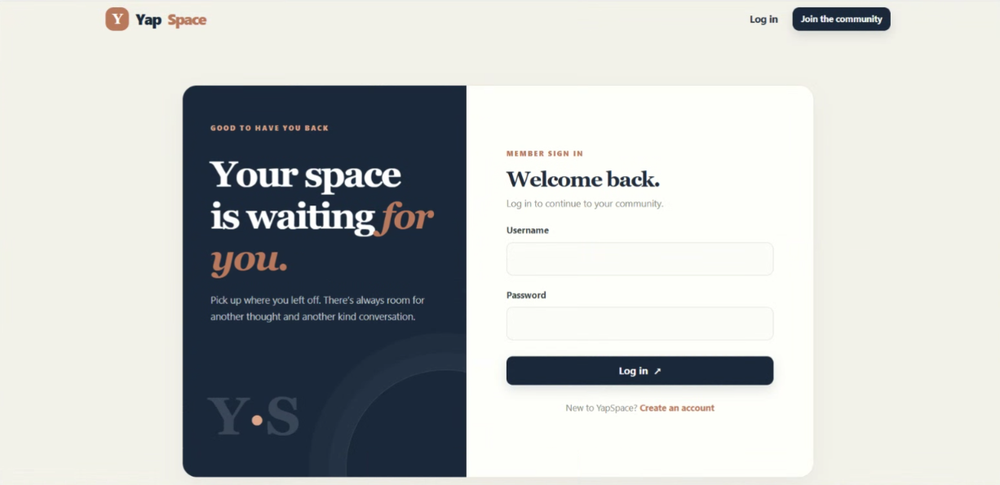

# 🩷 YapSpace — Your Thoughts Have a Place Here!

<div align="center">

  

  <br>

  <h2>🌸 A little space for every thought, story, and connection. 🌸</h2>

  <p>
    <strong>Welcome to YapSpace!</strong><br>
    A community platform where people can share their thoughts,<br>
    express themselves, and connect through conversations.
  </p>

  <br>

  
  
  
  

  <br>

  **✨ Share • Connect • Express • Yap ✨**

</div>

---

## 🎀 Explore YapSpace

<div align="center">

| 🌷 Discover | 💗 Explore |
|:---:|:---:|
| [About](#-about-yapspace) | [Features](#-what-can-you-do) |
| [Screenshots](#-take-a-peek-inside) | [OOP Principles](#-oop-principles) |
| [Technologies](#-technologies-used) | [Installation](#-get-started) |
| [Our Team](#-meet-the-creators) | [Acknowledgment](#-special-thanks) |

</div>

---

## 🌸 About YapSpace

**YapSpace** is a Java-based community web application designed to give users a welcoming space to express their thoughts and interact with other people.

Through its simple and user-friendly interface, users can create posts, share their feelings, react to posts, and participate in conversations through comments.

Our goal is to create a digital space where every thought has a place and every user has the opportunity to express themselves.

> 💌 Because sometimes, all you need is a little space to yap!

---

## 💬 What Can You Do?

<details>
<summary>🌷 <strong>Account Management</strong></summary>

- Create a user account through registration.
- Log in using an existing account.
- Log out securely from the application.

</details>

<details>
<summary>🩷 <strong>Community Feed</strong></summary>

- Explore posts shared by users.
- View conversations in the community.
- Interact with posts through available reactions.

</details>

<details>
<summary>✨ <strong>Create and Manage Posts</strong></summary>

- Create your own posts.
- Edit your existing posts.
- Delete your own posts.
- Organize your thoughts using available categories and feelings.

</details>

<details>
<summary>💗 <strong>Reactions and Comments</strong></summary>

- React to posts using:
  - Support
  - Relate
  - Encourage
- Leave comments on posts.
- Engage in conversations with the community.

</details>

<details>
<summary>🎀 <strong>My Posts</strong></summary>

- View your own published posts.
- Manage your contributions to the community.

</details>

---

## 📸 Take a Peek Inside

<blockquote>
Explore the actual interface of YapSpace! Click each section to reveal its screenshot.
</blockquote>

<details>
<summary>🏡 <strong>01 — Landing Page</strong></summary>

<div align="center">

  

  <p><em>Your thoughts have a place here.</em></p>

</div>

</details>

<details>
<summary>🔐 <strong>02 — Login Page</strong></summary>

<div align="center">

  

  <p><em>Welcome back to your space!</em></p>

</div>

</details>

<details>
<summary>💬 <strong>03 — Community Feed</strong></summary>

<div align="center">

  

  <p><em>Discover thoughts and connect through conversations.</em></p>

</div>

</details>

<details>
<summary>✍️ <strong>04 — Create a Post</strong></summary>

<div align="center">

  

  <p><em>Every thought deserves a space.</em></p>

</div>

</details>

---

## 🧩 OOP Principles

YapSpace is developed using Object-Oriented Programming (OOP) concepts. The four fundamental principles provide a foundation for organizing and structuring the application's code.

<details>
<summary>🎀 <strong>01 — Encapsulation</strong></summary>

Encapsulation groups data and the methods that operate on that data within a class. It helps protect an object's internal information and controls how that information is accessed or modified.

**Application in YapSpace:** Used in organizing application data and related operations within classes.

</details>

<details>
<summary>🌷 <strong>02 — Inheritance</strong></summary>

Inheritance allows a class to acquire properties and behaviors from another class. It promotes code reuse and helps establish relationships between classes.

**Application in YapSpace:** Provides a way to reuse shared properties and behaviors where inheritance relationships are implemented in the application.

</details>

<details>
<summary>💜 <strong>03 — Polymorphism</strong></summary>

Polymorphism allows objects to take different forms and enables methods to behave differently depending on the object or implementation.

**Application in YapSpace:** Supports flexible behavior through polymorphic methods and implementations where used in the application.

</details>

<details>
<summary>🦋 <strong>04 — Abstraction</strong></summary>

Abstraction hides unnecessary implementation details and focuses on the essential features of an object.

**Application in YapSpace:** Helps organize the application's operations by separating responsibilities into appropriate components and layers.

</details>

---

## 🛠️ Technologies Used

<div align="center">

| Technology | Purpose |
|:---|:---|
| ☕ Java | Main programming language |
| 🌐 HTML | Web page structure |
| 🎨 CSS | User interface styling |
| 🗂️ TSV Files | Local application data storage |
| 🧰 JDBC / MySQL Connector | Database connectivity components included in the project |

</div>

### 💾 How Data Is Stored

YapSpace currently uses **local TSV (Tab-Separated Values) files** through its `DataStore` implementation.

The application stores its data in files such as:

- `users.tsv`
- `posts.tsv`
- `comments.tsv`
- `reactions.tsv`

These files are stored in the application's local `data/` directory.

**Important:** The current application runtime uses local TSV storage. It does not currently use a shared online database, so data is not automatically synchronized across different computers.

---

## 🚀 Get Started

Follow these steps to run YapSpace on your computer.

### 1. Clone the Repository

```bash
git clone https://github.com/dolienteronabels-gif/YapSpace.git
```

### 2. Open the Project Folder

```bash
cd YapSpace
```

### 3. Compile the Java Files

Open PowerShell in the project folder and execute:

```powershell
New-Item -ItemType Directory -Force out

$files = Get-ChildItem -Recurse src -Filter *.java |
    ForEach-Object { $_.FullName }

javac -cp "lib\mysql-connector-j-26.10.0.jar" -d out $files
```

### 4. Run YapSpace

```powershell
java -cp "out;lib\mysql-connector-j-26.10.0.jar" yapspace.Main
```

### 5. Open in Your Browser

Once the application starts, visit:

**http://localhost:8080**

<div align="center">

  🎉 **You're now ready to explore YapSpace!** 🎉

</div>

---

## 📁 Project Structure

```text
YapSpace/
│
├── assets/
│   └── yapspace-animated-banner.gif
│
├── screenshots/
│   ├── landing-page.png
│   ├── login-page.png
│   ├── community-feed.png
│   └── create-post.png
│
├── database/
│
├── lib/
│   └── mysql-connector-j-26.10.0.jar
│
├── src/
│   └── yapspace/
│       ├── exception/
│       ├── model/
│       ├── repository/
│       ├── service/
│       ├── storage/
│       ├── web/
│       └── Main.java
│
├── README.md
├── Dockerfile
└── YapSpace.java
```

---

## 👩‍💻 Meet the Creators

<div align="center">

### 🌸 TEAM 4 — RO RO ROW YOUR CODE 🌸

*Three minds. One mission. One space to yap.*

</div>

| Team Member | Role |
|:---|:---|
| **Doliente, Ronabel E.** | 👑 Team Leader |
| **Ebora, Rodalyn R.** | 💻 Lead Programmer |
| **Panganiban, Kristelle Mhae B.** | 🎨 UI Designer |

---

## 💌 Special Thanks

<div align="center">

### To Our Instructor

**Ms. Fatima Marie P. Agdon**

We sincerely appreciate your guidance, patience, and support throughout the development of our project.

Your lessons and feedback helped us understand and apply the concepts of Object-Oriented Programming in developing YapSpace.

<br>

### 🏫 Presented to

**Batangas State University – The National Engineering University**  
Alangilan Campus  
Bachelor of Science in Information Technology

<br>

**Course:** BS Information Technology

<br>

🌷 *Made with dedication, teamwork, and lots of code!* 🌷

</div>

---

<div align="center">

## 🩷 Thank You for Visiting YapSpace!


### 💬 Your thoughts matter. Your voice belongs here.

**YapSpace — A little corner of the internet made for you.**

🌸 ✨ 💗 🦋 💬

</div>
