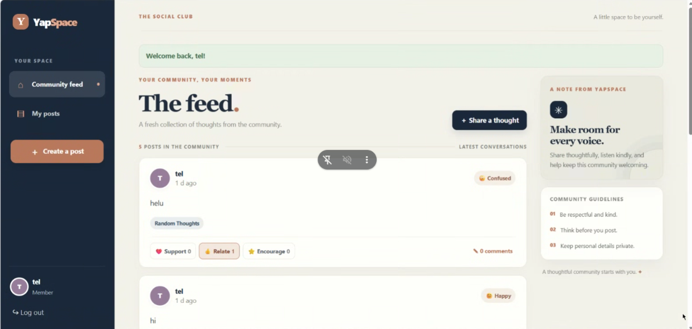

# ✨ YapSpace
### Your thoughts have a place here.
**Share a little. Connect a lot.**

<p align="center">
  
  
  
</p>

<p align="center">
  <i>A simple space for sharing thoughts, expressing feelings, and connecting with others.</i>
</p>

---

## 🌿 About YapSpace

**YapSpace** is a Java-based social networking application designed to give users a welcoming space to express themselves and interact with a community.

Whether sharing a thought, talking about an experience, or responding to someone else's post, YapSpace makes online interaction simple and meaningful.

More than just a place to post, YapSpace encourages people to share their voices, connect through conversations, and build a positive online community.

### 💡 Our Mission
To create a welcoming digital space where everyone can freely express their thoughts and connect through meaningful interactions.

### 🎯 Our Vision
To make online communication more engaging, accessible, and community-centered—one post at a time.

---

## 🚀 What You Can Do with YapSpace

| Feature | Description |
|---|---|
| 👤 User Registration | Create an account and become part of the community. |
| 🔐 User Login | Access your account securely through the login page. |
| 📰 Community Feed | Explore posts shared by other users. |
| ✍️ Create Posts | Share your thoughts, experiences, and ideas. |
| 📝 Edit and Delete Posts | Manage your own published posts. |
| 🏷️ Post Categories | Organize posts through categories. |
| 😊 Feelings | Express the emotion behind your post. |
| ❤️ Reactions | Respond using Support, Relate, and Encourage. |
| 💬 Comments | Interact with posts through conversations. |
| 📌 My Posts | View and manage your own contributions. |
| 🚪 Logout | Safely leave your account. |

---

## 🖥️ A Closer Look at YapSpace

<p align="center">
  <b>Every thought deserves a space. Here's ours.</b>
</p>

### 🏠 Landing Page
The starting point of YapSpace, welcoming users into the platform.

<p align="center">
  
</p>

### 🔐 Login Page
A simple login interface where registered users can access their accounts.

<p align="center">
  
</p>

### 📰 Community Feed
The heart of YapSpace, where users can discover posts and interact with the community.

<p align="center">
  
</p>

### ✍️ Create a Post
A space where users can share their thoughts, choose a category, and express how they feel.

<p align="center">
  
</p>

---

## 🧩 Object-Oriented Programming Principles

YapSpace uses the four fundamental principles of Object-Oriented Programming (OOP), which help organize code and support a structured application design.

### 1. 🔒 Encapsulation
Encapsulation keeps an object's data protected by controlling how other parts of the program access and modify it.

**In YapSpace:** User-related and post-related data can be organized within classes, with access controlled through appropriate methods.

### 2. 🧬 Inheritance
Inheritance allows one class to acquire properties and behaviors from another class, helping reduce repeated code.

**In YapSpace:** Related classes can share common properties and methods through a parent class and its child classes.

### 3. 🎭 Polymorphism
Polymorphism allows the same method or operation to behave differently depending on the object using it.

**In YapSpace:** Related classes can provide their own implementations of inherited methods when different behaviors are needed.

### 4. 🧠 Abstraction
Abstraction hides unnecessary implementation details and focuses on the essential operations of a system.

**In YapSpace:** Application components can separate what an operation does from the details of how it is performed.

---

## 🛠️ Built With

| Technology | Purpose |
|---|---|
| ☕ Java | Main programming language |
| 🧩 Object-Oriented Programming | Organizing the application's code |
| 🌐 HTML | Structuring web pages |
| 🎨 CSS | Styling the user interface |
| 📁 TSV File Storage | Storing application data locally |
| 💻 Visual Studio Code | Development environment |
| 🐙 Git and GitHub | Version control and collaboration |

---

## 📂 Project Structure

```text
YapSpace/
│
├── database/
│
├── lib/
│   └── mysql-connector-j-26.10.0.jar
│
├── src/
│   └── yapspace/
│       ├── exception/
│       ├── model/
│       ├── repository/
│       ├── service/
│       ├── storage/
│       ├── web/
│       └── Main.java
│
├── .gitignore
├── Dockerfile
├── README.md
├── YapSpace.java
└── diagram (1).png
```

---

## ⚙️ Getting Started

Follow these steps to run YapSpace on your local computer.

### Prerequisites

Make sure you have the following installed:

- Java Development Kit (JDK)
- Visual Studio Code or another Java-compatible IDE
- Git (optional, for cloning the repository)

### 1. Clone the Repository

```bash
git clone https://github.com/dolienteronabels-gif/YapSpace.git
```

### 2. Open the Project

```bash
cd YapSpace
```

Open the project folder in Visual Studio Code.

### 3. Compile the Java Files

For Windows PowerShell:

```powershell
New-Item -ItemType Directory -Force out
$files = Get-ChildItem -Recurse src -Filter *.java | ForEach-Object { $_.FullName }
javac -cp "lib\mysql-connector-j-26.10.0.jar" -d out $files
```

### 4. Run YapSpace

```powershell
java -cp "out;lib\mysql-connector-j-26.10.0.jar" yapspace.Main
```

### 5. Open in Your Browser

Once the application starts, open your browser and visit:

```text
http://localhost:8080
```

You can now explore YapSpace locally!

---

## 📌 Current Project Notes

- YapSpace runs locally on the computer where it is started.
- Application data is stored in local TSV files.
- Data is not automatically shared or synchronized between different computers.
- The application must be run locally to access its features.

---

## 👥 Meet the Developers

**Team 4 — Ro Ro Row Your Code**

| Member | Role |
|---|---|
| [Member 1] | [Role / Contribution] |
| [Member 2] | [Role / Contribution] |
| [Member 3] | [Role / Contribution] |
| [Member 4] | [Role / Contribution] |

*Developed as an academic project for the application of Java programming and Object-Oriented Programming concepts.*

---

## 💬 A Little Note from the Team

We created YapSpace with one simple idea in mind: everyone has something worth sharing.

Every post starts with a thought. Every comment starts a conversation. And every interaction creates an opportunity to connect.

We hope YapSpace reminds you that even the smallest thought deserves a place.

<p align="center">
  <b>YapSpace — Your thoughts have a place here. 💬</b>
</p>

<p align="center">
  Made with ☕, creativity, and teamwork by <b>Team 4 — Ro Ro Row Your Code</b>
</p>
