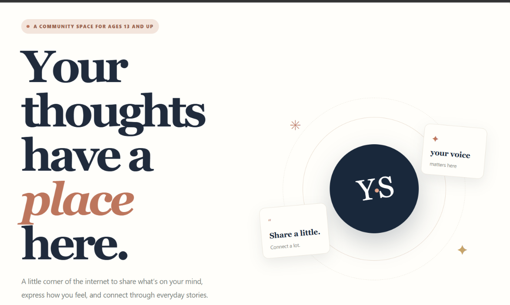
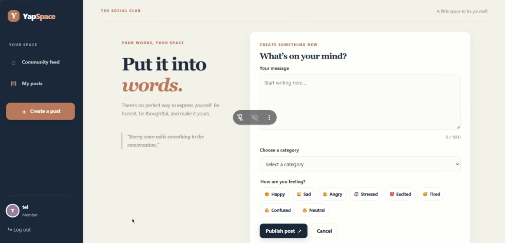

<!-- ================================================== -->
<!--                    YAPSPACE                        -->
<!--       Your thoughts have a place here.             -->
<!-- ================================================== -->

<!-- ANIMATED HEADER -->

<p align="center">
  
</p>

<h1 align="center">YapSpace</h1>

<p align="center">
  <strong>Your thoughts have a place here.</strong>
  <br />
  <em>Share a little. Connect a lot.</em>
</p>

<p align="center">
  
  
  
</p>

<p align="center">
  <a href="#-about-yapspace">About</a> •
  <a href="#-features">Features</a> •
  <a href="#-screenshots">Screenshots</a> •
  <a href="#-oop-principles">OOP Principles</a> •
  <a href="#-technologies-used">Technologies</a> •
  <a href="#-how-to-run">How to Run</a> •
  <a href="#-meet-the-team">Team</a>
</p>

---

## 💬 About YapSpace

**YapSpace** is a community-based social platform designed to give users a space to express their thoughts, share experiences, and connect with others.

With a simple, welcoming, and user-friendly interface, YapSpace encourages people to share what is on their minds and interact with a community.

Our goal is to create a digital space where every thought matters and every voice has a place.

<p align="center">
  <strong>Think it. Share it. Yap it.</strong>
</p>

---

## ✨ Features

| Feature | Description |
|---|---|
| 👤 User Registration | Allows new users to create an account. |
| 🔐 User Login | Allows registered users to access their accounts. |
| 🏠 Community Feed | Displays posts shared by the community. |
| ✍️ Create a Post | Allows users to share their thoughts. |
| 📝 Edit and Delete Posts | Allows users to manage their own posts. |
| 💬 Comments | Allows users to interact through comments. |
| ❤️ Reactions | Users can Support, Relate, and Encourage posts. |
| 📂 My Posts | Displays posts created by the logged-in user. |
| 🚪 Logout | Allows users to end their current session. |

---

## 📸 Screenshots

Explore the different pages of YapSpace by expanding each section below!

<details>
<summary>🏠 <strong>Landing Page</strong> — Welcome to YapSpace</summary>

<br />

<p align="center">
  
</p>

<p align="center">
  <em>Your thoughts have a place here.</em>
</p>

</details>

<details>
<summary>🔐 <strong>Login Page</strong> — Access your account</summary>

<br />

<p align="center">
  
</p>

</details>

<details>
<summary>💬 <strong>Community Feed</strong> — Connect with the community</summary>

<br />

<p align="center">
  
</p>

</details>

<details>
<summary>✍️ <strong>Create a Post</strong> — Share your thoughts</summary>

<br />

<p align="center">
  
</p>

</details>

---

## 🧠 OOP Principles

YapSpace is developed using the four fundamental principles of **Object-Oriented Programming (OOP)**.

Explore each principle below!

<details>
<summary>🔒 <strong>1. Encapsulation</strong></summary>

Encapsulation is the process of combining data and methods into a single class while controlling access to the data.

**Application in YapSpace:**

User and post-related information are organized within their respective classes. This helps keep the application's data organized and manageable.

</details>

<details>
<summary>🧬 <strong>2. Inheritance</strong></summary>

Inheritance allows a class to acquire properties and methods from another class, promoting code reusability.

**Application in YapSpace:**

Related classes can inherit common properties and behaviors from parent classes where inheritance is implemented.

</details>

<details>
<summary>🔄 <strong>3. Polymorphism</strong></summary>

Polymorphism allows methods or operations to behave differently depending on the object or implementation involved.

**Application in YapSpace:**

The application can use different implementations of shared behaviors where polymorphism is implemented in its Java classes.

</details>

<details>
<summary>🎭 <strong>4. Abstraction</strong></summary>

Abstraction hides unnecessary implementation details and presents only the essential functionality.

**Application in YapSpace:**

The application separates its internal operations into different components, allowing functionality to be organized without exposing every implementation detail to the user.

</details>

---

## 🛠️ Technologies Used

| Technology | Purpose |
|---|---|
| ☕ Java | Main programming language |
| 🌐 HTML | Structures the web pages |
| 🎨 CSS | Designs and styles the interface |
| 📁 TSV File Storage | Stores application data locally |
| 🐙 Git and GitHub | Version control and collaboration |
| 💻 Visual Studio Code | Development environment |

---

## 📂 Project Structure

```text
YapSpace/
│
├── assets/
│   └── yapspace-animated-banner.gif
│
├── screenshots/
│   ├── landing-page.png
│   ├── login-page.png
│   ├── community-feed.png
│   └── create-post.png
│
├── lib/
│   └── mysql-connector-j-26.10.0.jar
│
├── src/
│   └── yapspace/
│       ├── exception/
│       ├── model/
│       ├── repository/
│       ├── service/
│       ├── storage/
│       ├── web/
│       └── Main.java
│
├── README.md
├── Dockerfile
└── YapSpace.java
```

---

## 🚀 How to Run

Follow these steps to run YapSpace on your local computer.

### 1. Clone the Repository

```bash
git clone https://github.com/dolienteronabels-gif/YapSpace.git
```

### 2. Open the Project Folder

```bash
cd YapSpace
```

### 3. Compile the Java Files

Run the following commands in PowerShell:

```powershell
New-Item -ItemType Directory -Force out

$files = Get-ChildItem -Recurse src -Filter *.java | ForEach-Object { $_.FullName }

javac -cp "lib\mysql-connector-j-26.10.0.jar" -d out $files
```

### 4. Run YapSpace

```powershell
java -cp "out;lib\mysql-connector-j-26.10.0.jar" yapspace.Main
```

### 5. Open in Your Browser

```text
http://localhost:8080
```

<p align="center">
  <strong>🎉 Welcome to YapSpace!</strong>
</p>

---

## ⚠️ Project Limitations

The current version of YapSpace has the following limitations:

- Application data is stored locally using TSV files.
- Data is not automatically synchronized between different computers.
- Private messaging is not currently available.
- Image uploads in posts are not currently supported.
- Post searching and reporting are not currently available.

---

## 👥 Meet the Team

<p align="center">
  <strong>TEAM 4</strong>
  <br />
  <em>Ro Ro Row Your Code</em>
</p>

| Team Member | Designation |
|---|---|
| **Doliente, Ronabel E.** | Team Leader |
| **Ebora, Rodalyn R.** | Lead Programmer |
| **Panganiban, Kristelle Mhae B.** | UI Designer |

### 🎓 Academic Information

- **Institution:** Batangas State University – Alangilan Campus
- **Program:** Bachelor of Science in Information Technology
- **Project:** YapSpace
- **Instructor:** Ms. Fatima Marie P. Agdon

---

## 🙌 Acknowledgment

We would like to express our sincere gratitude to our instructor, **Ms. Fatima Marie P. Agdon**, for her guidance, support, and valuable knowledge throughout the development of this project.

We also acknowledge the effort, teamwork, and dedication of every member of Team 4 in bringing YapSpace to life.

This project has been an opportunity for us to apply our knowledge of Java programming, Object-Oriented Programming, and web development while improving our collaboration and problem-solving skills.

---

<p align="center">
  
</p>

<h2 align="center">💭 YapSpace</h2>

<p align="center">
  <strong>Your thoughts have a place here.</strong>
  <br />
  Share a little. Connect a lot.
</p>

<p align="center">
  <sub>Designed with creativity. Built with collaboration. Powered by code. ❤️</sub>
</p>

<p align="center">
  <a href="#yapspace">⬆ Back to Top</a>
</p>
